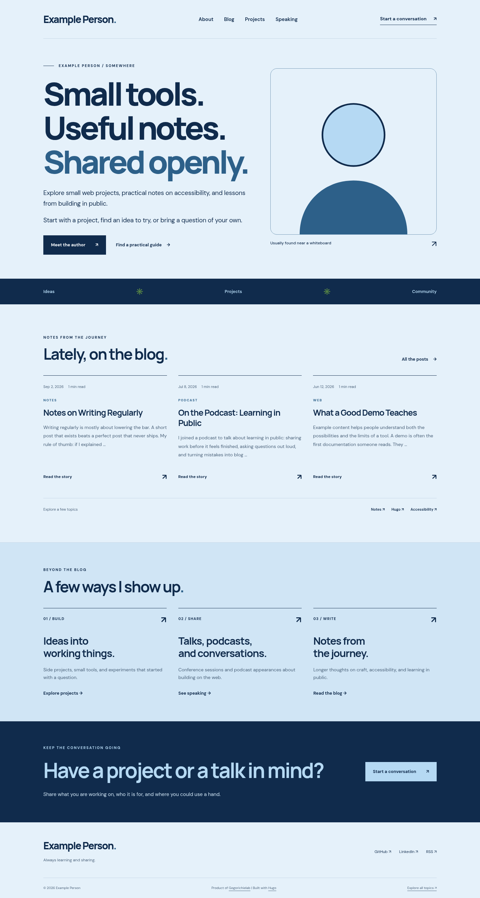

# 2026 Personal Brand Theme

[](https://github.com/Gogorichielab/2026-personal-brand-theme/releases/latest)
[](https://github.com/Gogorichielab/2026-personal-brand-theme/releases)
[](https://github.com/Gogorichielab/2026-personal-brand-theme/blob/main/LICENSE)
[](https://github.com/Gogorichielab/2026-personal-brand-theme/actions/workflows/pages.yml)
[](https://github.com/Gogorichielab/2026-personal-brand-theme/actions/workflows/release.yml)
[](https://gogorichielab.github.io/2026-personal-brand-theme/)

[](https://github.com/Gogorichielab/2026-personal-brand-theme/graphs/contributors)
[](https://github.com/Gogorichielab/2026-personal-brand-theme/commits/main/)
[](https://github.com/Gogorichielab/2026-personal-brand-theme/graphs/commit-activity)

[](https://github.com/Gogorichielab/2026-personal-brand-theme/issues)
[](https://github.com/Gogorichielab/2026-personal-brand-theme/issues?q=is%3Aissue%20is%3Aclosed)
[](https://github.com/Gogorichielab/2026-personal-brand-theme/pulls)
[](https://github.com/Gogorichielab/2026-personal-brand-theme/pulls?q=is%3Apr%20is%3Aclosed)
[](https://github.com/Gogorichielab/2026-personal-brand-theme/commits/main/)

[](https://github.com/Gogorichielab/2026-personal-brand-theme)
[](https://github.com/Gogorichielab/2026-personal-brand-theme)
[](https://github.com/Gogorichielab/2026-personal-brand-theme)
[](https://github.com/Gogorichielab/2026-personal-brand-theme)

[](https://gohugo.io/installation/)
[](https://github.com/Gogorichielab/2026-personal-brand-theme/blob/main/.github/workflows/pages.yml)
[](https://github.com/Gogorichielab/2026-personal-brand-theme/tree/main/layouts)
[](https://github.com/Gogorichielab/2026-personal-brand-theme/tree/main/assets/css)
[](https://github.com/Gogorichielab/2026-personal-brand-theme/tree/main/assets/js)
[](https://www.conventionalcommits.org/)

[](https://gogorichielab.github.io/2026-personal-brand-theme/)
[](#blog-search)
[](https://gogorichielab.github.io/2026-personal-brand-theme/blog/index.xml)
[](#search-and-social-previews)
[](https://github.com/Gogorichielab/2026-personal-brand-theme/blob/main/layouts/_partials/seo-schema.html)

A responsive Hugo theme that puts a person and their work up front, with the blog close behind. It includes a configurable homepage, post archive, optional client-side search, author details, social links, project highlights, and an optional speaking page layout.



## Requirements

- Hugo Extended 0.146.0 or later

Every pull request builds and tests the theme on Hugo 0.146.0 and the four newest releases (0.165.0 through 0.168.0).

## Install

Add the theme as a Git submodule:

```sh
git submodule add https://github.com/Gogorichielab/2026-personal-brand-theme.git themes/2026-personal-brand-theme
```

Set the theme in your Hugo configuration:

```toml
theme = "2026-personal-brand-theme"
```

The theme uses your `Site.Title`, main menu, content, and Hugo taxonomies. Set the parameters you need to personalize the homepage and shared site chrome:

```toml
[params.author]
	name = "Example Person"
	location = "Somewhere"
	image = "images/portrait.jpg"
	image_alt = "Example Person"
	bio = "A short author biography."

[params.brand]
	name = "Example"
	mark = "."
	connect_url = "https://example.org/contact/"
	connect_text = "Let's connect"
	about_url = "about/"
	github_url = "https://github.com/example"
	footer_tagline = "Always learning and sharing."

[params.home]
	headline = ["Curiosity.", "Ideas."]
	headline_accent = "Community."
	intro = ["A short introduction to your work.", "Add another paragraph if useful."]
	areas = ["What you do", "What you build", "Who you help"]
	about_url = "about/"
	blog_url = "blog/"
	topics = ["Technology", "Projects"]
	cta_url = "https://example.org/contact/"

[[params.social]]
	name = "GitHub"
	url = "https://github.com/example"
```

Homepage highlights are optional repeatable entries:

```toml
[[params.home.highlights]]
	eyebrow = "01 / Build"
	title_lines = ["Ideas into", "working things."]
	description = "A short description of this area."
	url = "projects/"
	link_text = "Explore projects"
```

## Page Headings

Section and page headings have defaults you can replace in each page's front matter:

| Page | Front matter keys |
| --- | --- |
| Blog and other lists (`content/blog/_index.md`, …) | `eyebrow`, `heading` |
| Projects (`content/projects/_index.md`) | `eyebrow`, `heading`, `list_heading`, `github_text` |
| Speaking (`content/speaking/index.md`) | `eyebrow`, `invite_text`, `profile_text` |

```yaml
---
title: "Blog"
eyebrow: "Writing"
heading: "Notes and essays"
---
```

## Blog Search

Search is opt-in. To enable it, add `enabled = true` under `[params.search]`, configure a `Search` output format, and add `Search` to the outputs for your blog section:

```toml
[params.search]
	enabled = true

[outputFormats.Search]
	mediaType = "application/json"
	baseName = "search"
	isPlainText = true
	notAlternative = true
```

```yaml
outputs: ["HTML", "RSS", "Search"]
```

## Related Articles

Blog posts can end with a short list of related articles. It is off by default:

```toml
[params.related]
  enabled = true
  limit = 3                     # default 3
  heading = "Related articles"  # optional
```

The theme uses Hugo's [related content](https://gohugo.io/content-management/related/) and lists only blog posts, never the current post. Drafts and future posts are left out unless your build includes them. When nothing matches, the section isn't shown. Hugo decides relevance from your site's `[related]` settings; Hugo's defaults only suggest older posts. The example site makes shared tags decide relevance and lets newer posts appear:

```toml
[related]
  includeNewer = true
  threshold = 80
  toLower = true
  [[related.indices]]
    name = "tags"
    weight = 100
  [[related.indices]]
    name = "date"
    weight = 10
```

Results are ordered by relevance and are the same on every build of the same content.

## Copy Buttons on Code

Add a **Copy code** button above every code block in your posts:

```toml
[params.copy_code]
  enabled = true
```

The button copies the code exactly, without line numbers, and confirms with "Copied". Screen readers hear the same confirmation, and focus stays on the button. If the browser blocks clipboard access, the button says "Copy failed" and the code can still be selected by hand. The small script loads only on pages that contain code, or on posts with sharing turned on. Without JavaScript, no button appears.

## Sharing

Add a share row to blog posts:

```toml
[params.share]
  enabled = true
  destinations = ["linkedin", "bluesky", "email"]  # any of: linkedin, bluesky, x, email
```

Each destination is a plain link with the post's title and canonical URL encoded into it. No third-party scripts are loaded and nothing is tracked. Only the destinations you list appear, and an unknown name stops the build. A **Copy link** button copies the post's canonical URL. If the browser blocks clipboard access, the link is shown so it can be copied by hand. Without JavaScript, the copy button doesn't appear, but the share links still work.

## Translations

All text the theme writes itself (labels, buttons, search messages, dates and screen-reader text) comes from translation files. The theme ships English (`i18n/en.toml`) and Spanish (`i18n/es.toml`). To add a language, copy `i18n/en.toml` to `i18n/<code>.toml` in your site and translate the values. Dates follow each language's conventions automatically.

A key missing from a language falls back to your site's default language. If your default language has no translation file, copy `en.toml` for it, or its labels will be empty.

On a multilingual site, the header shows a language switcher. It links to the translated version of the current page, or to that language's homepage when there isn't one. Single-language sites don't show it. Give each language a `language_label` param for the switcher, otherwise the language code is shown:

```toml
[languages.en]
  weight = 1
  [languages.en.params]
    language_label = "English"
[languages.es]
  weight = 2
  [languages.es.params]
    language_label = "Español"
    [languages.es.params.home]
      headline = ["Pequeñas herramientas.", "Notas útiles."]
```

Text you write in params and front matter, such as homepage headlines or button labels, is translated per language as shown above. Settings you don't override are shared. Links to the blog and the About page follow the current language. Other links you set in params are used as written.

## Article Images

JPEG and PNG images stored next to a post (in its page bundle) are converted to WebP, capped at 1600px wide, and offered in 480, 800 and 1200px versions (never wider than the original) with `srcset` and `sizes`, so phones download a smaller file. Other formats and external image URLs are used as they are.

## Contact Links

Set `params.brand.connect_url` and `params.home.cta_url` to a relative page path such as `contact/`, a full HTTPS URL, or a `mailto:` link. The speaking page's `invite_url` and `profile_url` accept the same formats. Relative paths respect your site's `baseURL`, including a GitHub Pages subpath.

The example site includes a demo contact page. Replace its instructions with your own contact details before publishing; it does not send messages.

## Search and Social Previews

Give important pages a `description` in front matter. The theme uses it for the search description, Open Graph tags, and Twitter card tags. Without one, it uses a page's `lead`, then its content summary; the homepage uses `params.description`. Topic archives get descriptions based on their topic. Paginated archives have their own canonical URLs and page numbers in their titles.

For a social preview image, set `images` to a list of image paths in front matter:

```yaml
description: "What readers will learn from this article."
images: ["cover.png"]
image_alt: "A short description of the preview image."
```

An image in a page bundle is resolved from that bundle. Static images can use paths such as `images/social-card.png` (a leading `/` also works under a subpath), and absolute HTTPS image URLs are also supported. Set `params.images` and `params.image_alt` in the site configuration for a default social image. `image_alt` becomes the preview's alternative text; a page's own `image_alt` only applies to its own image. Pages without an image use a summary card.

## Brand Colors

Pick a color preset and override individual colors under `params.colors`. Without any settings, the theme uses the `navy` preset.

```toml
[params.colors]
  preset = "forest"   # "navy" (default), "forest" or "night"
  accent = "#1f5c8a"  # optional: overrides the preset's value
  appearance = "auto" # optional: "light" (default) or "auto"
```

With `appearance = "auto"`, visitors whose system is set to dark mode see the built-in `night` palette. It switches with the system setting, needs no JavaScript and doesn't flash the wrong colors on load. Your color overrides apply to the light palette only. `preset = "night"` makes a site always dark. There's no on-page toggle yet.

Each color is the preset's value unless you set it. Colors must be hex values such as `#2d6089`. An unknown preset or `appearance` value, an unknown color name or a value that isn't a hex color stops the build with a message naming the setting.

| Key | Used for |
| --- | --- |
| `ink` | Main text and dark sections |
| `muted` | Secondary text |
| `accent` | Links and hover states |
| `sky`, `pale` | Highlights and soft backgrounds |
| `paper` | Page background |
| `line` | Borders and rules |
| `focus` | Keyboard focus outline |
| `band` | The "Beyond the blog" band, and light text on dark sections |
| `frame`, `frame_border` | Portrait background and border |
| `stage` | Speaking page background |
| `rule` | Dividers between talks |
| `surface` | Form fields, the skip link and text on accent buttons |

All three built-in presets meet WCAG AA contrast for body text. Custom colors are not checked, so test your own palette with a contrast checker before publishing.

## Validation

Run `python3 -m unittest discover -s tests -v` with Hugo Extended available as `hugo`, or set `HUGO_BIN` to its executable path. The integration checks build the demo at both a domain root and a subpath, then check metadata, archive pagination, contact links, and search data.

See [`exampleSite/`](exampleSite/) for a working minimal setup, deployed as a live demo at <https://gogorichielab.github.io/2026-personal-brand-theme/>. The build command from the theme repository is:

```sh
hugo --source exampleSite --themesDir ../.. --theme 2026-personal-brand-theme --minify
```

## License

MIT. See [LICENSE](LICENSE).
